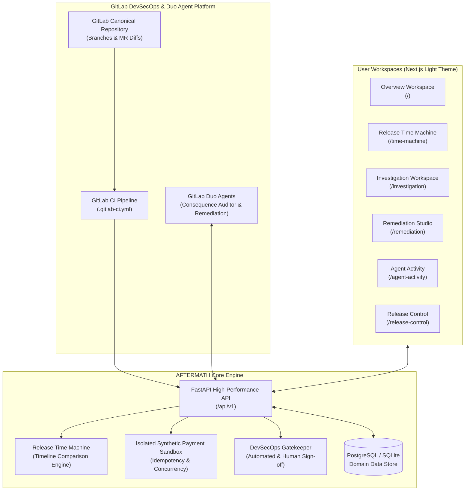
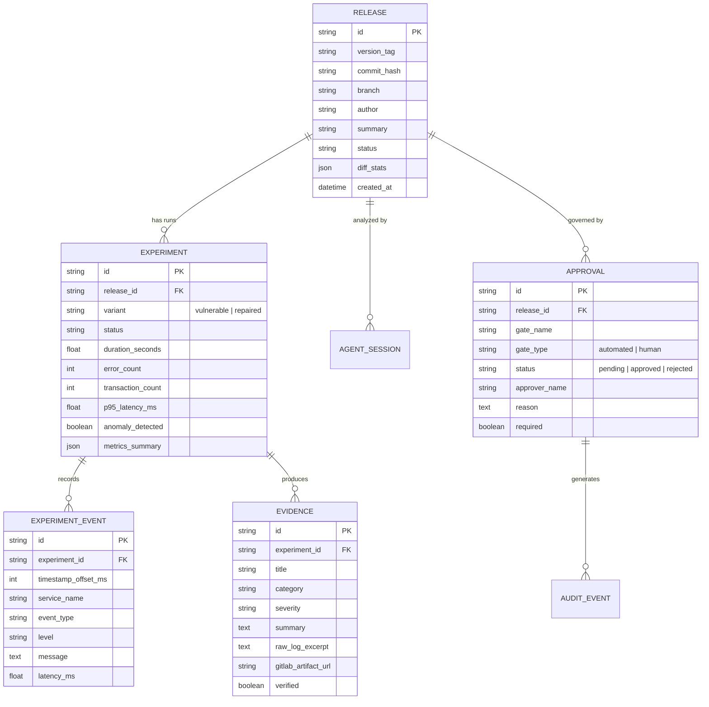

# AFTERMATH — System Architecture & Design Specification

> **Product**: AFTERMATH — The Release Time Machine  
> **Tagline**: Every release has consequences. See them before production.  
> **Competition**: GitLab Life After Code Hackathon (Deadline: October 27, 2026, 15:00 GMT+2)

---

## 1. Executive Overview

Modern continuous delivery pipelines deploy code based on passing unit tests and synthetic staging smoke tests. However, critical outages (such as double-billing, connection pool exhaustion, and race cascades) occur when multi-service concurrency under network retries violates implicit distributed invariants.

**AFTERMATH** introduces the **Release Time Machine**: an empirical counterfactual laboratory that couples **GitLab Duo Agent Platform** with deterministic simulation and isolated synthetic service sandboxes. Before a release is certified for production, AFTERMATH spins up empirical runs of both the proposed release and a repaired counterfactual variant, compares chronological execution timelines side-by-side, surfaces concrete evidence, and evaluates strict verification gates.

---

## 2. System Architecture



---

## 3. Modular Monorepo Organization

The project is structured as a clean, modular monorepo:

```
AFTERMATH/
├── backend/                        # Python 3.11+ FastAPI Application
│   ├── app/
│   │   ├── api/                    # Typed REST API endpoints for the 5 workspaces
│   │   │   ├── health.py           # /healthz and /readyz liveness/readiness probes
│   │   │   ├── overview.py         # /api/v1/overview operational summary
│   │   │   ├── time_machine.py     # /api/v1/time-machine/compare/{release_id}
│   │   │   ├── investigation.py    # /api/v1/investigation/{release_id} graph data
│   │   │   ├── agent_activity.py   # /api/v1/agent-activity Duo execution traces
│   │   │   ├── release_control.py  # /api/v1/release-control gates & approvals
│   │   │   └── synthetic_payment.py# /api/v1/synthetic-payment sandbox API
│   │   ├── models/                 # SQLAlchemy 2.0 Async Domain Models
│   │   │   ├── release.py
│   │   │   ├── experiment.py
│   │   │   ├── experiment_event.py
│   │   │   ├── evidence.py
│   │   │   ├── agent_session.py
│   │   │   ├── approval.py
│   │   │   ├── audit_event.py
│   │   │   └── synthetic_transaction.py
│   │   ├── schemas/                # Pydantic v2 Request/Response Schemas
│   │   ├── services/               # Core business services & fixtures
│   │   │   ├── synthetic_payment.py# Isolated payment concurrency simulator
│   │   │   └── seed_data.py        # Deterministic benchmark dataset loader
│   │   ├── config.py               # Pydantic Settings & environment variables
│   │   ├── database.py             # Async database engine & session dependency
│   │   └── main.py                 # FastAPI application factory & lifespan
│   ├── alembic/                    # Database version migrations
│   │   └── versions/001_initial_schema.py
│   ├── tests/                      # Pytest unit and integration test suite
│   ├── requirements.txt            # Backend dependencies
│   ├── pyproject.toml              # Tooling configuration
│   └── Dockerfile                  # Container definition
│
├── src/                            # Frontend (Next.js 15 App Router, TypeScript)
│   ├── app/
│   │   ├── layout.tsx              # Root HTML & metadata shell
│   │   ├── page.tsx                # Route A: Operational Overview Workspace
│   │   ├── time-machine/page.tsx   # Route B: Signature Release Time Machine
│   │   ├── investigation/page.tsx  # Route C: Investigation Workspace & Causal Graph
│   │   ├── agent-activity/page.tsx # Route D: GitLab Duo Agent Execution History
│   │   ├── release-control/page.tsx# Route E: Verification Gates & Human Sign-off
│   │   └── globals.css             # Light-theme tokens and custom typography
│   ├── components/
│   │   ├── navigation-shell.tsx    # Header, navigation tabs, status indicators
│   │   └── providers.tsx           # TanStack Query React provider
│   └── lib/
│       ├── api.ts                  # Typed client for all backend endpoints
│       └── simulation/             # Counterfactual discrete-time simulation engine
│
├── docs/                           # Documentation & Specifications
│   ├── ARCHITECTURE.md             # This document
│   └── MILESTONE_1_ACCEPTANCE.md   # Milestone 1 acceptance verification gates
│
├── .gitlab-ci.yml                  # GitLab CI/CD Pipeline definition
├── .github/workflows/ci.yml        # GitHub Mirror Actions Pipeline
├── docker-compose.yml              # Production/staging orchestration
├── Dockerfile.frontend             # Frontend container definition
├── LICENSE                         # MIT License
├── README.md                       # Product documentation & quickstart
└── .env.example                    # Environment template
```

---

## 4. Domain Data Model



---

## 5. Isolated Synthetic Payment Service

To prove release consequences without risking production assets, AFTERMATH provides an isolated synthetic payment service (`app/services/synthetic_payment.py`).

### Failure Mode Modeled: Concurrency & Idempotency Breach
When an asynchronous checkout pipeline dispatches retries without atomic distributed mutex locking:
1. **Under Vulnerable Release (`rel-2026-001`)**: Duplicate HTTP requests with identical idempotency keys (`idem_99014`) are processed concurrently across worker threads, executing debit transactions twice against customer ledgers ($120.00 charged x 2 = $240.00 billed).
2. **Under Repaired Release (`exp-rep-001`)**: A Redis `SETNX` distributed lock with atomic deduplication intercepts subsequent retries, returning cached 200 OK responses without double charging.

---

## 6. GitLab Duo Agent Platform Integration

AFTERMATH integrates with GitLab Duo:
- **Duo Consequence Auditor**: Analyzes merge request git diffs, extracts touched components, and designs empirical scenario profiles.
- **Duo Remediation Engineer**: Synthesizes minimal remediation patches (e.g., atomic distributed locks) to resolve detected consequences.
- **Honest Connection State**: When unconfigured, the UI clearly displays step-by-step instructions for personal access token configuration rather than fabricating artificial live runs.

---

## 7. Security & Governance Boundaries

1. **Strict CORS Policy**: Restricted to configured origins (default: `http://localhost:3000`).
2. **Input Validation**: Pydantic v2 schemas reject malformed payloads with 422 Unprocessable Entity.
3. **Immutable Audit Trail**: Human approvals and gate status changes generate cryptographic audit event logs (`audit_events` table).
4. **No Simulated Production Deployment**: Real releases are blocked or certified for staging; production deployment is never simulated as real.

---

## 8. Autonomous Remediation & Isolated Worktree Sandbox (Milestone 4)

Milestone 4 introduces genuine, supervised code remediation:
1. **Target Concurrency Defect**: `services/payment_worker/processor.py` represents the real payment settlement worker. Under concurrent retries, missing synchronization violates `INV-PAY-001` (multiple debits per order).
2. **Unified Diff Synthesis**: The remediation engine compares the unpatched target against an atomic barrier implementation (`asyncio.Lock` with in-flight reservation map), generating a standard GNU unified diff with SHA-256 fingerprinting.
3. **Dual-Phase Sandboxed Verification**:
   - Creates an ephemeral worktree in a temporary directory.
   - Executes `pytest services/payment_worker/test_processor.py` against unpatched code (verifying failure: Exit Code 1, 5 debits).
   - Applies the patch in the sandbox.
   - Executes `pytest` against patched code (verifying resolution: Exit Code 0, 3/3 passed).
4. **State Machine Transitions**:
   `DETECTED` $\to$ `INVESTIGATING` $\to$ `PATCH_PROPOSED` $\to$ `VALIDATING` $\to$ `AWAITING_APPROVAL` $\to$ `APPROVED / COMPLETED` (or `REJECTED`).
5. **Supervised Gatekeeper**:
   Autonomous auto-merge is prohibited. Progression requires human approval (name, email, note) or rejection (reviewer, reason), writing immutable records to `audit_events`.

